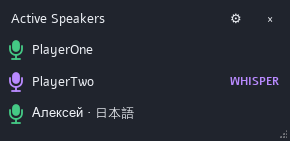

# WhosTalkin

A native C++17 TeamSpeak **3** plugin with a small independent Qt window showing
only active speakers. Normal speech has a green microphone. Incoming whispers
have a purple microphone and `WHISPER`. The window is empty when nobody is talking.

Author: **Khivus**. Download the [latest Windows release](https://github.com/khivus/WhosTalkin/releases/latest).



```text
┌─ Active Speakers ───────── ⚙ × ┐
│ 🎤 PlayerOne                   │
│ 🎤 PlayerTwo           WHISPER │
│ 🎤 Иван · 日本語               │
└───────────────────────────────┘
```

## Compatibility

| Component | Requirement / checked configuration |
| --- | --- |
| Client | Classic TS3 3.6.x desktop, plugin API **26** |
| Local client inspected | Windows x64 TS3 **3.6.2**, Qt DLL version **5.15.2.0** |
| Qt | **5.15.2**, shared Core/Gui/Widgets, matching the client's compiler ABI |
| Windows | x64, MSVC-compatible compiler, Release build |
| Build executed | MSVC **19.29.30159** / v142, SDK **10.0.19041.0**, CMake **3.31.8**, Qt **5.15.2 msvc2019_64** |
| Linux | x86_64 with Qt 5.15.2 GCC-compatible shared libraries; build recipe provided, untested here |
| Not supported | TS3 3.5.x/API 25, TeamSpeak 5/6, Qt 6, Windows MinGW plugin builds, 32-bit clients |

The [official SDK](https://github.com/teamspeak/ts3client-pluginsdk) is pinned to
`4aa90a53aa150cbf81e13bc97e68c0431b26499f`. The requested
[Qt template](https://github.com/Gamer92000/TeamSpeak3-Qt-Plugin-Template) was
examined before implementation. The installed client's changelog records the
API 26 change in TS3 3.6.0 for Qt compatibility. This plugin checks the host Qt
version again during initialization. Match the runtime exactly and do not copy
development Qt DLLs into the TS3 installation.

MSVC v142 was used rather than the template's v140 setting. Microsoft documents
[binary compatibility of the MSVC 14.x toolchains](https://learn.microsoft.com/en-us/cpp/porting/binary-compat-2015-2017).
An appropriate x64 Visual C++ runtime must already be installed; use Release
builds to avoid debug Qt/CRT dependencies.

## Install and use

1. Close TS3 and download [WhosTalkin-1.0.1-win64.ts3_plugin](https://github.com/khivus/WhosTalkin/releases/download/v1.0.1/WhosTalkin-1.0.1-win64.ts3_plugin).
   Open it with TeamSpeak's package installer, or download and copy **only**
   `whostalkin_win64.dll` from the release into its plugin folder.
   A normal per-user installation uses `%APPDATA%\TS3Client\plugins`.
   Portable/local-config installations use their own plugin folder.
2. Start TS3. Enable **WhosTalkin** in **Tools > Options > Addons > Plugins** if needed.
3. Use **Plugins > WhosTalkin > Show / hide Active Speakers** or **Settings**.
4. Drag the title strip to move the window; resize its native frame or bottom-right
   grip. `×` hides it. Reopen from the menu without restarting TS3.

Chat commands:

```text
/whostalkin show
/whostalkin hide
/whostalkin toggle
/whostalkin settings
/whostalkin reset
```

A `Show / hide Active Speakers` plugin hotkey is also available in TS3's hotkey
settings. No key combination is assigned automatically.

Settings and geometry are stored in **`whostalkin.ini` in the config directory
returned by TS3**, normally `%APPDATA%\TS3Client`. They are saved on settings
changes, hiding, and unload. `startVisible` controls startup visibility separately
from the current window being hidden. Reset position recovers an offscreen window.

### Settings

- Window: always on top (default on), start visible (on), hide from taskbar (on),
  opacity (95%), scale (75–200%, including window dimensions and fonts), optional frameless mode, dark/light theme, automatic
  height (on), and maximum height. Overflow within the maximum height scrolls.
- Speakers: active users only (mandatory), whisper styling, own microphone,
  maximum displayed speakers, and alphabetical or speaking-start ordering.
- Behavior: active server tab only by default; optional all-server display with
  a server label on each row. This uses only activity TS3 actually exposes.
- Removal delay: **0 ms by default**. A nonzero value up to 300 ms intentionally
  holds a stopped row briefly to smooth PTT transitions. Disconnect and mute
  removal bypass this delay. Set it to 0 for strictly current activity.
- Whisper target display is disabled with an explanation because API 26 provides
  no trustworthy received-target metadata.

The speaker window is parentless and uses show-without-activation, so routine
speaker changes do not request keyboard focus. It is designed to remain visible
when TS3 is minimized. Exclusive fullscreen applications can cover ordinary
desktop windows; this plugin does not hook or modify games.

## Whisper metadata

| SDK data | Display / limitation |
| --- | --- |
| `onTalkStatusChangeEvent(server, status, isReceivedWhisper, client)` | Incoming whisper boolean for that server/client identity |
| `CLIENT_NICKNAME` | Current UTF-8 nickname, with a client-ID fallback if unavailable |
| `CLIENT_FLAG_TALKING`, `isReceivingWhisper` | One-time active-state recovery when enabling the plugin / connecting / changing own channel |
| `isWhispering` for the local client | Optional outgoing `WHISPER OUT`, queried on local talking events |
| Received target type or target ID | **Not exposed by the public API 26 SDK** |

The public `GroupWhisperType` / `GroupWhisperTargetMode` enums describe whisper
configuration concepts. They do not add recipient metadata to received talking
callbacks. `requestClientSetWhisperList` sets a sender's channel/client list; it
does not reveal another sender's received target list.

Consequently, incoming server-group, channel-group, all-client, individual-client,
channel, commander, and other whisper targets all show **`WHISPER` without a
target name**. No membership or nickname inference is performed. Outgoing
detection also provides a boolean rather than target names and is refreshed on
talking events, not continuously polled. See [SDK investigation](docs/sdk-research.md).

## Architecture

`plugin.cpp` exports the native C ABI. Talking, movement, nickname, mute,
disconnect and server-tab callbacks enqueue value-only events to a controller
on the host's Qt GUI thread. SDK lookups use the client's cached public APIs;
no network requests, audio processing, packet capture or private client access
are introduced. `SpeakerStore` keys every row by `(server handler ID, client ID)`.
Nickname equality never merges users. Normal/whisper transitions update one row.

The canvas repaints current rows without recreating widgets or animating them.
Hidden windows continue tracking. A single-shot timer exists only for opted-in
delayed removal. No recurring poll, background service or helper process is
needed. One initial snapshot queries talking flags, then resolves only active
users; snapshots also recover activity once after server connection and own
channel changes. Own-channel changes clear normal speech and retain incoming
whispers until their stop/disconnect event.

Unload stops accepting callbacks, synchronously destroys windows and settings,
and deletes the receiver so Qt removes its pending events before the DLL is
released. Only initialization/shutdown can use a GUI-thread lifecycle barrier;
talk callbacks never wait for GUI execution. This follows Qt's
[GUI thread and QObject lifetime rules](https://doc.qt.io/archives/qt-5.15/threads-qobject.html).

## Build on Windows

Install the **Desktop development with C++** workload in Visual Studio 2019 or
newer, an x64 MSVC toolset and Windows SDK, CMake >=3.21, Git, and **Qt 5.15.2
MSVC 2019 64-bit**. Use the matching/newer MSVC toolset, not MinGW. Python 3 is
only used by the optional packaging script, never by the plugin.

From an **x64 Native Tools Command Prompt**, using your actual Qt path:

```bat
cmake -S . -B build -G "NMake Makefiles" -DCMAKE_BUILD_TYPE=Release -DCMAKE_PREFIX_PATH=C:/Qt/5.15.2/msvc2019_64
cmake --build build
set PATH=C:\Qt\5.15.2\msvc2019_64\bin;%PATH%
ctest --test-dir build --output-on-failure
python tools/package.py --binary build/whostalkin_win64.dll --output dist
```

CMake fetches the pinned official SDK automatically. For an offline build,
clone it beforehand and pass `-DTS3_SDK_DIR=C:/path/to/ts3client-pluginsdk`.
If Git's Windows TLS backend reports `SEC_E_NO_CREDENTIALS`, an installed Git
OpenSSL backend can be selected using `git -c http.sslBackend=openssl clone ...`;
certificate verification stays enabled.

With a Visual Studio generator, add `-A x64`, use `--config Release` for build
and `-C Release` for CTest; the DLL is then in `build/Release`. Never package a
Debug build. If CMake finds Python, `cmake --build build --target package_plugin`
is an alternative to invoking the script.

This workspace also contains **local-only build tools** in `.cache` and a
`.cache/build.cmd` which rebuilds with those downloaded paths. That cache is
ignored, machine-specific, and not needed for an ordinary source checkout.

## Build on Linux

Install GCC with C++17, CMake >=3.21, Git, and the **Qt 5.15.2 gcc_64** development
kit. Use the client's corresponding Qt version rather than a distribution's
newer Qt 5.15.x or Qt 6. Ensure the client and plugin use compatible C++ runtimes.

```sh
cmake -S . -B build -DCMAKE_BUILD_TYPE=Release -DCMAKE_PREFIX_PATH="$HOME/Qt/5.15.2/gcc_64"
cmake --build build -j2
export LD_LIBRARY_PATH="$HOME/Qt/5.15.2/gcc_64/lib${LD_LIBRARY_PATH:+:$LD_LIBRARY_PATH}"
ctest --test-dir build --output-on-failure
python3 tools/package.py --binary build/whostalkin_linux_amd64.so --output dist
```

Install the `.so` in the TS3 plugin directory (normally the client's `plugins`
directory). Linux builds and desktop behavior have not been executed here.
On Wayland, taskbar/topmost behavior depends on the compositor; TS3 commonly
uses X11/XWayland. Ordinary desktop windows cannot guarantee exclusive fullscreen
visibility on either platform.

## Simulator and tests

```bat
build\whostalkin_simulator.exe
```

Put the development Qt `bin` directory on PATH first. The standalone simulator
uses the same controller and speaker window with a mock source: two servers,
duplicate nicknames across servers, Unicode, normal/whisper switches, own audio,
and disconnect controls. It has a separate `simulator.ini`; it never connects
to a TS server. Closing its control window exits the simulation.

For deterministic screenshot generation without touching saved simulator settings:

```bat
set QT_QPA_PLATFORM=offscreen
set QT_QPA_FONTDIR=%WINDIR%\Fonts
build\whostalkin_simulator.exe --preview docs/active-speakers.png
```

For core-only tests without Qt or an SDK:

```sh
cmake -S . -B build-core -DWHOSTALKIN_BUILD_PLUGIN=OFF -DWHOSTALKIN_BUILD_SIMULATOR=OFF
cmake --build build-core
ctest --test-dir build-core --output-on-failure
```

Automated suites cover all ten requested cases, including no-target whispers,
duplicate identities, rapid PTT, server switching, and visible-window unload.
The DLL-host suite uses the actual exported callbacks with a mock SDK function
table, verifies GUI-thread SDK queries and allocation cleanup, and unloads and
reloads the binary. The Qt suites use the offscreen platform. See
[executed validation and remaining live checks](docs/validation.md).

## Troubleshooting

- **Plugin missing / incompatible API:** use the x64 classic TS3 3.6.x client,
  put the DLL in that client's plugin folder, and enable it in Addons. API 25
  clients and newer TeamSpeak products cannot load this API 26 plugin.
- **DLL load error:** check architecture and the x64 Visual C++ runtime. Keep
  `Qt5Core.dll`, `Qt5Gui.dll`, and `Qt5Widgets.dll` supplied by TS3. Do not install
  the simulator's development Qt DLLs into TS3. Check the client log for WhosTalkin
  initialization messages.
- **Window hidden/offscreen:** use `/whostalkin show` or `/whostalkin reset`.
  Check startup visibility, opacity and server-tab filtering.
- **No speaker rows:** silence intentionally produces an empty window. Muted or
  disabled own microphone activity is excluded. All-server mode does not grant
  audio access to other channels or otherwise unavailable server audio.
- **Stopped row remains briefly:** set removal delay to **0 ms**.
- **No whisper target:** expected SDK limitation, not a missing permission.
- **Cannot save settings:** check write access to the client's config directory.
  Failures are logged through TS3 rather than silently dropping the write.
- **Simulator fails to start:** set PATH to the matching Qt `bin`, and if needed
  `QT_PLUGIN_PATH` to the kit's `plugins` directory. Do not use the TS3 install's
  plugin directory as a Qt development-kit path.

## License

WhosTalkin source is [MIT](LICENSE). It is free and independent of TeamSpeak
Systems GmbH. Dependencies retain their own terms; see [third-party notes](THIRD_PARTY.md).
